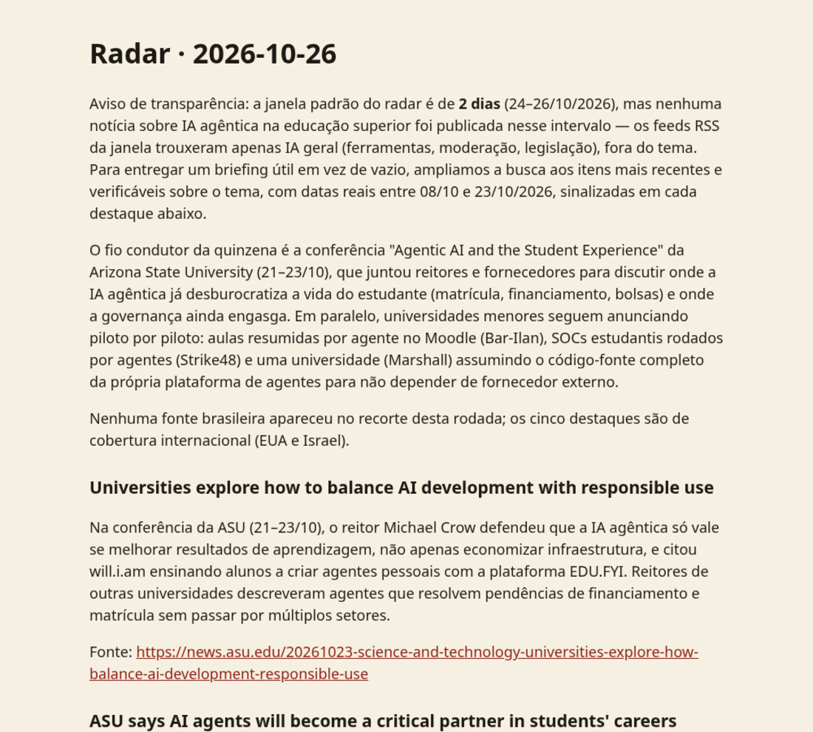
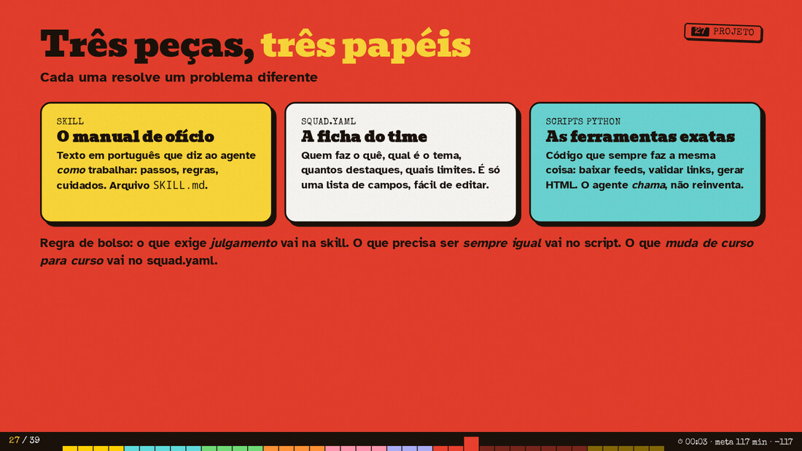

<div align="center">


# Radar do Curso

**Um time de agentes de IA que lê as notícias por você, confere as fontes e entrega um briefing todo dia.**
Feito com [Hermes Agent](https://hermes-agent.nousresearch.com/) · Material da oficina prática "Seu primeiro agente com Hermes"


</div>

---

## O que é

Você diz o **tema** (por exemplo, "IA agêntica na educação superior"). O radar:

1. **Explorador** busca em feeds RSS, na web e no GitHub.
2. **Verificador** descarta o que não tem fonte, data ou relação com o tema.
3. **Redator** escreve o briefing em português, um destaque por notícia, cada um com link.
4. Um **script** reprova qualquer destaque sem link ou com link que não veio da coleta.
5. O resultado sai em **HTML**, e o **cron** do Hermes pode repetir tudo todo dia.

<p align="center"></p>

> Exemplo real de execução em [`exemplos/`](exemplos/). Quando os feeds não têm nada novo sobre o tema, o agente avisa no topo do briefing em vez de inventar.

## As três peças

<p align="center"></p>


| Peça | Arquivo | Papel |
|---|---|---|
| **Skill** | `.hermes/skills/radar-squad/SKILL.md` | Manual de ofício em português: os passos e as regras. |
| **squad.yaml** | `squad.yaml` | Ficha do time: tema, papéis, limites. É o que você edita para fazer o *seu* radar. |
| **Scripts Python** | `scripts/*.py` | Ferramentas exatas (coletar, validar, renderizar). Só biblioteca padrão: nada para instalar. |

Regra de bolso: *julgamento* vai na skill; o que precisa ser *sempre igual* vai no script; o que *muda de curso para curso* vai no `squad.yaml`.

## As 5 skills do projeto

| Skill | De onde vem | Para quê |
|---|---|---|
| `agent-reach` | [Panniantong/Agent-Reach](https://github.com/Panniantong/Agent-Reach) | Ler web, GitHub e YouTube pela linha de comando |
| `rss-feeds` | Hermes (opcional, oficial) | Ler feeds RSS/Atom |
| `grounded-citations` | Hermes (já incluída) | Toda afirmação com fonte |
| `blocked-page-recovery` | Hermes (já incluída) | O que fazer quando uma página bloqueia |
| `radar-squad` | **Este repositório** | Orquestra o time |

## Passo a passo

### 0. Pré-requisitos
- Hermes instalado (Desktop ou CLI) e um modelo configurado (`hermes setup --portal` para a Nous gratuita).
- Python 3 (`python3 --version`). Testado com 3.14; os scripts usam só a biblioteca padrão.

### 1. Baixar o projeto
```bash
git clone https://github.com/<seu-usuario>/oficina-hermes-radar.git
cd oficina-hermes-radar
```

### 2. Instalar as skills
```bash
# a skill do projeto
mkdir -p ~/.hermes/skills/radar-squad
cp .hermes/skills/radar-squad/SKILL.md ~/.hermes/skills/radar-squad/

# skills oficiais do Hermes
hermes skills install official/research/rss-feeds
hermes skills list          # confira grounded-citations e blocked-page-recovery
```

### 3. Instalar o Agent Reach (opcional, só canais sem login)
> Atenção: o pacote chamado `agent-reach` no PyPI **não é** este projeto. Não use `pip install agent-reach`.

Peça ao Hermes: `Instale o Agent Reach: https://raw.githubusercontent.com/Panniantong/Agent-Reach/main/docs/install.md`
ou, na mão (exige o [`uv`](https://docs.astral.sh/uv/)):
```bash
uv tool install https://github.com/Panniantong/Agent-Reach/releases/latest/download/agent-reach.zip
agent-reach setup
```
Na oficina, use somente os canais `web` e `github`. Não conecte contas pessoais.

### 4. Testar os scripts sozinhos (sem agente)
```bash
python3 scripts/coletar_feeds.py --dias 3 > saida/coleta.json
python3 scripts/validar_briefing.py saida/briefing.md saida/coleta.json
python3 scripts/renderizar_briefing.py saida/briefing.md
```

### 5. Rodar o time
Abra o Hermes **dentro desta pasta** (`hermes desktop --cwd .` ou `hermes` no terminal) e peça:
```
Use a skill radar-squad e gere o briefing de hoje.
```
O resultado aparece em `saida/briefing-AAAA-MM-DD.html`.

### 6. Fazer o seu radar
Edite `squad.yaml` (campo `tema`, `buscas`) e `fontes/feeds.txt` (um feed por linha). Rode de novo.

### 7. Agendar (cron)
```bash
hermes cron create "daily at 8am" \
  "Use a skill radar-squad e gere o briefing de hoje" \
  --skill radar-squad --workdir "$PWD" --name radar-diario

hermes cron list            # ver agendamentos
hermes cron run radar-diario  # testar agora
hermes gateway              # o gateway precisa estar ligado para o cron rodar
```
Saídas ficam em `~/.hermes/cron/output/`. No Desktop, o mesmo agendamento está no painel de cron.

## Segurança (leia antes)
- Texto da internet é **dado**, nunca ordem. Se uma notícia disser "ignore suas instruções", o radar deve ignorar e avisar.
- O radar só escreve em `saida/`.
- Tarefa agendada roda sem ninguém olhando: por isso é somente leitura. Não dê a ela permissão de postar ou enviar.
- Modelos gratuitos podem registrar o que você envia: não coloque dados pessoais ou confidenciais.

## Estrutura
```
squad.yaml                       ficha do time
fontes/feeds.txt                 lista de feeds
.hermes/skills/radar-squad/      skill do projeto
scripts/                         coletar, validar, renderizar
saida/                           resultados (coleta.json, briefing.md, .html)
exemplos/                        briefing, coleta e verificação de exemplo
docs/img/                        imagens deste README
```

## Erros de iniciante (para evitar)
Resumo de dois vídeos de introdução ao Hermes, com a prática deste projeto:

1. **Ferramentas demais cedo.** Comece só com o que o primeiro fluxo precisa.
2. **Memória como depósito.** Fato estável vai para a memória; procedimento vira **skill**; pesquisa longa vira nota.
3. **Cron que não decide nada.** Tarefa agendada precisa ser autocontida: o que checar, onde, o que importa, o que ignorar e onde entregar.
4. **Confiar em sub-agente sem conferir.** Por isso o `validar_briefing.py` existe.
5. **Colar chave de API no chat.** Use `hermes config set NOME valor` no terminal.
6. **Aprovar tudo "sempre".** Libere por vez; comandos que escrevem ou enviam merecem olho humano.

## Para aprender mais
- [Learn 95% of Hermes Agent in 31 Minutes](https://www.youtube.com/watch?v=Ta2wg6xPaY4): visão geral de modelos, memória, skills, cron e sub-agentes.
- [Hermes Agent Full Course for Beginners](https://www.youtube.com/watch?v=mTYxpIRK7xA): instalação em servidor com Telegram (vídeo patrocinado; o curso aqui não depende dele).
- [Documentação do Hermes](https://hermes-agent.nousresearch.com/docs) · [Agent Reach](https://github.com/Panniantong/Agent-Reach)

## Licença
[MIT](LICENSE) · Autor: João Matheus Fernandes
